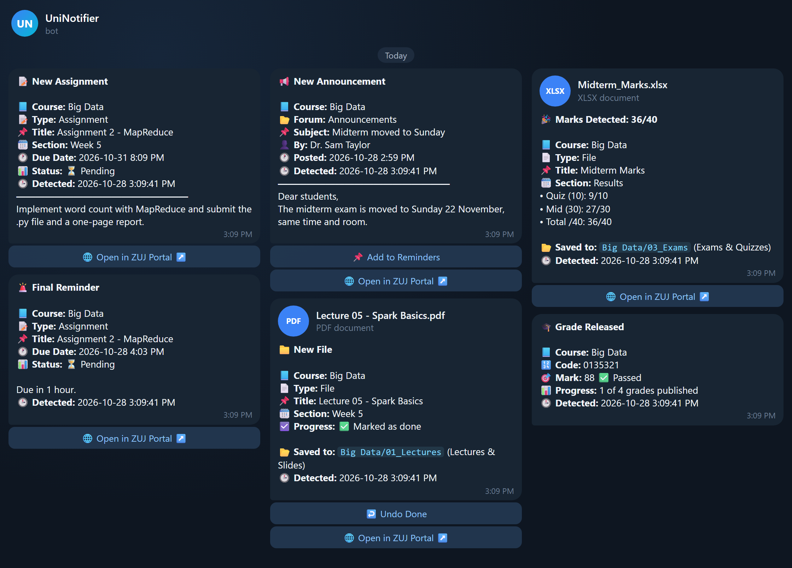
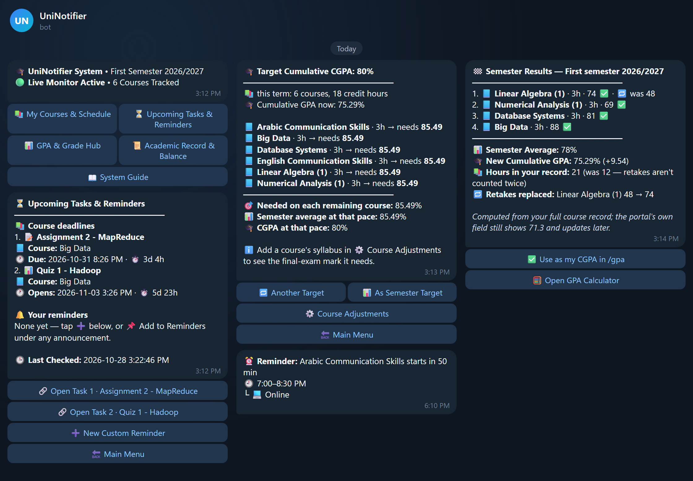
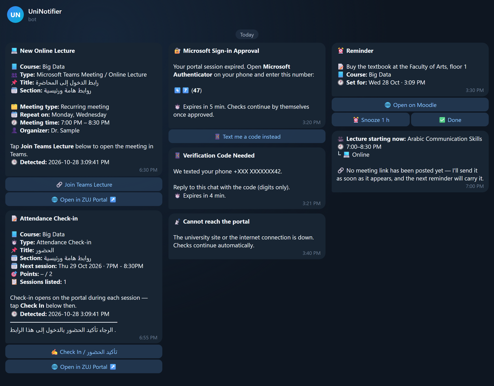

**العربية** | [English](README.md)

---

<div align="center">

[](https://www.python.org/downloads/)
[](https://www.microsoft.com/windows)
[](https://github.com/Humam-Taibeh/UniNotifier/actions/workflows/tests.yml)
[](https://github.com/PyCQA/pyflakes)
[](LICENSE)

</div>

# UniNotifier

**جامعتك على هاتفك — لحظة حدوث أي تغيير.**

يراقب UniNotifier منصة Moodle الخاصة بجامعة الزيتونة الأردنية (`elearning.zuj.edu.jo`) من جهازك
الشخصي الذي يعمل بنظام Windows، ويرسل كل ما يهمك إلى تطبيق Slack خاص بك وحدك (أو بوت تيليجرام إن فضّلت): الملفات الجديدة،
والواجبات، والاختبارات القصيرة (Quizzes)، والإعلانات ومنشورات المنتديات، وتذكيرات مواعيد التسليم،
وتنبيهات المحاضرات الإلكترونية مع زر **Join** للانضمام، وكشف العلامات والرصيد المالي عند الطلب،
وأداة لتخطيط المعدل. كما يحفظ كل ملف من ملفات المواد في مجلد مرتّب خاص بكل مادة.

يعمل بهدوء في الخلفية عبر مهمتين مجدولتين في Windows، ولا يحتاج إلى خادم ولا إلى اشتراك، ولا يغادر
جهازك أي شيء يخصك سوى الرسائل التي يرسلها إلى Slack *الخاص بك*.

- [المزايا](#المزايا) · [كيف يبدو](#كيف-يبدو)
- [التثبيت في 3 خطوات](#التثبيت-في-3-خطوات)
- [الاستخدام اليومي](#الاستخدام-اليومي) · [أين تحفظ الملفات](#أين-تحفظ-الملفات) · [إضافات اختيارية](#إضافات-اختيارية)
- [التحديث والإيقاف المؤقت والإزالة](#التحديث-والإيقاف-المؤقت-والإزالة) · [حل المشكلات](#حل-المشكلات) · [الأمان والخصوصية](#الأمان-والخصوصية) · [بنية النظام](#بنية-النظام)
- كل سلوك بالتفصيل: **[docs/REFERENCE.md](docs/REFERENCE.md)** (بالإنجليزية)

---

## المزايا

| | |
|---|---|
| 📚 **كل ما على Moodle لحظة نشره** | الملفات والمجلدات والروابط والصفحات والملصقات (Labels) والاختبارات القصيرة والواجبات ومنشورات المنتديات والإعلانات ومحاضرات Teams وتسجيل الحضور — كلٌّ منها بلقطة شاشة واضحة للعنصر نفسه، أو الملف نفسه (حتى 45 ميغابايت)، في رسالة قصيرة. وعند التعديل يُبيّن ما الذي تغيّر (*Was* / *Now*)، ويُبلغك أيضاً عند إعادة رفع ملف. |
| 🗂️ **أرشيف مرتّب** | يُحفظ كل ملف في `<Course>\01_Lectures` أو `02_Assignments` أو `03_Exams`، ولا يُحفظ مرتين أبداً؛ وعندما يرفع المدرّس نسخة جديدة تحلّ محلّ القديمة، وتنتقل القديمة إلى `_Old_Versions`. |
| 📅 **جدولك، يقرؤه ويرسمه لك** | بوجود بيانات دخول بوابة الطالب في ملف `.env`، يقرأ البوت جدولك الأسبوعي من البوابة بنفسه — كل يوم ووقت وشعبة وقاعة ونوع الحصة — ويبني منه تنبيهات المحاضرات، ويرسمه صورةً وملف PDF لزر 📅 Weekly Timetable. لا حاجة لكتابة أي ملف؛ وإن كتبت `schedule.json` أو وضعت صورة جدول من عندك فهي المعتمدة. |
| ⏰ **مواعيد التسليم والمحاضرات** | تذكير بالواجبات والاختبارات القصيرة قبل موعدها بـ 24 ساعة وبساعة واحدة (ويتوقف عند تسليمك)، وكل يوم الساعة 12 ظهرًا قائمة بكل مهمة مفتوحة — ومنها Cambridge One — مع تنبيه 🚨 قوي في اليوم الأخير؛ وتنبيهات المحاضرات الإلكترونية قبل ساعة وعند بدايتها، مع زرَّي 🎥 Join Meeting و ✍️ Check In — وإن فعّلته، تسجيل الحضور تلقائياً مع لقطة شاشة دليلاً عليه (أو تنبيه 🚨 لتسجّله بنفسك). |
| 📌 **تذكيراتك الخاصة** | زر "Add to Reminders" تحت أي إشعار، أو ملاحظة تكتبها بنفسك — تصلك في الدقيقة المحددة تماماً. |
| 🎉 **علاماتك، يجدها لك** | علامة الاختبار القصير أو الواجب لحظة ظهورها على Moodle، مع صورة للصفحة؛ وسطرك في أي ملف علامات يرفعه المدرّس (Excel أو Word أو PDF أو نص) — يجده برقمك الجامعي `STUDENT_ID` في ملف `.env`. وإن لم يستطع قراءة ملف علامات أخبرك بذلك. |
| 📊 **العلامات والمعدل** | أداة Grade Needed لحساب ما تحتاجه لبلوغ معدل فصلي أو تراكمي مستهدف؛ واكتب مجموع أعمال الفصل لأي مادة مرة واحدة (`42/60`) لترى أعلى علامة ما زالت ممكنة وما تحتاجه في النهائي. وكشف العلامات والرصيد المالي عند الطلب، وميزة Finals Watch التي تُعلن كل علامة نهائية فور رصدها. |
| 🎓 **خطتك الدراسية كما هي** | كشف العلامات يحسب خطتك كما تعرضها البوابة — لأي تخصص وأي سنة خطة: الساعات المجتازة، وساعات هذا الفصل، والراسب الذي لم يُعَد بعد، والمتبقي الآن وبعد هذا الفصل، وامتحانات المستوى، وقائمة 📚 Remaining Courses مجموعةً مجموعة. وخاصية Guest Look-up تفعل الشيء نفسه لزميل. |
| 🗓️ **خطة التسجيل (Registration Plan)** | ماذا تسجّل في الفصل القادم، محسوباً من خطتك ومتطلباتها السابقة: اختر عدد الساعات (12 / 15 / 18، و21 في فصل التخرج أو بمعدل امتياز؛ 9 في الفصل الصيفي و12 إن كان فصلك الأخير) فيقترح عليك المواد ✨ — المادة الراسب بها أولاً، ثم المادة التي تفتح أكثر عدد من المواد بعدها — أو اخترها بنفسك ✋ من المواد المتاحة لك، مع حساب الساعات والتنبيه على القواعد مع كل ضغطة. وكل مادة غير متاحة بعد تُذكر تحت سببها: المادة التي يجب اجتيازها قبلها، أو اجتياز 90 ساعة (التدريب ومشروع التخرج — بموافقة رئيس القسم)، أو فصل التخرج فقط (العلوم العسكرية). أما الشُّعب والأيام والتسجيل التلقائي فتُفتح مع فترة التسجيل على البوابة. |
| 📝 **علامات الميد لحظة ظهورها** | عند ضبط بيانات البوابة يقرأ البوت موقع الامتحانات (`exams.zuj.edu.jo`، بنفس بيانات الدخول) كل 15 دقيقة ويرسل كل علامة فور ظهورها — الامتحان والعلامة من العلامة العظمى والنسبة — ويخبرك إن تغيّرت علامة لاحقاً. يبدأ بإخبارك أي المواد ظهرت علاماتها وأيها ينتظر. |
| 🛡️ **هادئ ويُصلح نفسه بنفسه** | فحص عبر HTTP مباشرة يستغرق نحو 10 ثوانٍ كل 15 دقيقة، ونظرة خفيفة جداً كل دقيقتين، وإعادة محاولة تلقائية، واكتشاف أعمال الصيانة على المنصة، وتمرير التحقق الثنائي من Microsoft إليك عبر تيليجرام، وبوت يعيد تشغيل نفسه، وتنبيهات حين يحتاج الأمر إلى تدخلك. |

---

## كيف يبدو

<p align="center">
  
</p>

**تنبيهات لحظة حدوثها:** مواعيد التسليم، والإعلانات، والملفات الجديدة (محفوظة لك)، والعلامات.

<p align="center">
  
</p>

**مساعدك الشخصي:** القوائم، والمهام القادمة، ومخطط المعدل («ماذا أحتاج؟»)، ونتائج فصلك.

<p align="center">
  
</p>

**المحاضرات والدخول والتذكيرات:** زر انضمام لمحاضرات Teams، والحضور، وتحقق Microsoft الثنائي من هاتفك، وتذكيراتك الخاصة.

*معاينات مرسومة بنصوص رسائل البوت الحقيقية وببيانات تجريبية مختلقة — الأسماء والمواد والعلامات كلها وهمية.
في تيليجرام تبدو بالشكل نفسه، بثيم تيليجرام عندك، وبأزرار قابلة للضغط.*

---

## التثبيت في 3 خطوات

نحو 15 دقيقة، ودون أن تحرّر أي ملف.

### 1. ثبّت Python و Git (مرة واحدة)

| تحتاج إلى | طريقة الحصول عليه | للتحقق |
|---|---|---|
| نظام Windows 10 أو 11 | جهاز يبقى مشغّلاً ومتصلاً بالإنترنت معظم اليوم: يعمل UniNotifier عليه، فما دام مطفأً أو في وضع السكون لا يُفحص شيء (ويعوّض ما فاته حين يعود) | — |
| إصدار **Python 3.11** أو أحدث | من [python.org/downloads](https://www.python.org/downloads/) — أداة التثبيت الافتراضية **Python install manager** تنزّل Python بنفسها عند أول تشغيل للأمر `py --version`؛ أما إن استخدمت المثبّت التقليدي ففعّل خيار **"Add python.exe to PATH"** | `py --version` |
| برنامج **Git** | من [git-scm.com/download/win](https://git-scm.com/download/win) (الإعدادات الافتراضية كافية) | `git --version` |
| تطبيق Slack | المجاني على هاتفك وجهازك — تنشئ مساحة العمل بنفسك في الخطوة 2 | — |
| حساب Microsoft الجامعي | الحساب الذي تسجّل به الدخول إلى Moodle، وتطبيق Authenticator إن كنت تستخدمه | — |

### 2. جهّز Slack الخاص بك (نحو 5 دقائق، مجاناً)

يعمل Slack على أي شبكة، ويعطيك المساعد كاملاً: قوائم وأزرار وبطاقات. أنت تنشئ مساحة عمل صغيرة خاصة بك وحدك،
ولا يدخلها أحد غيرك.

1. افتح **[slack.com/get-started](https://slack.com/get-started)** وأنشئ مساحة عمل مجانية (بأي اسم).
2. افتح **[api.slack.com/apps](https://api.slack.com/apps)** ← **Create New App** ← **From a manifest** ←
   اختر مساحة العمل ← **JSON**. المثبّت ينسخ لك إعدادات التطبيق: ما عليك إلا لصقها (**Ctrl+V**) ثم
   **Next ← Create**.
3. **Install to Workspace ← Allow**، ثم انسخ **Bot User OAuth Token** (يبدأ بـ `xoxb-`).
4. **Basic Information ← App-Level Tokens ← Generate Token and Scopes**: سمّه `socket`، وأضف الصلاحية
   `connections:write`، وانسخ الرمز (يبدأ بـ `xapp-`).

تفعل ذلك والمثبّت ينتظرك — يعيد عليك كل خطوة على الشاشة، ويتحقق من كل رمز تلصقه، ويتعرّف عليك في Slack
بنفسه. *(تفضّل تيليجرام؟ المثبّت يسألك أيهما تريد؛ انظر [تيليجرام بدلاً منه](#إضافات-اختيارية).)*

### 3. نزّل UniNotifier وشغّل المثبّت

افتح **PowerShell** (من قائمة Start اكتب "PowerShell") واكتب هذه الأسطر الأربعة:

```powershell
cd $HOME
git clone https://github.com/Humam-Taibeh/UniNotifier.git
cd UniNotifier
.\install.bat
```

المثبّت يتولّى كل ما تبقّى، ويخبرك بما يفعله في كل خطوة:

1. يجهّز UniNotifier على جهازك (بضع دقائق في المرة الأولى)؛
2. يسألك **بضعة أسئلة قصيرة** — أين تريد رسائلك (اضغط **Enter** لـ Slack)، وبريدك الجامعي وكلمة مروره،
   ثم رموز Slack من الخطوة 2، ثم بيانات دخول بوابة الطالب (اختيارية، لكنها ما يقرأ منه جدولك)
   وهل يسجّل حضورك في المحاضرات الإلكترونية؛
3. يتحقق من كل شيء، ويفتح نافذة متصفح لتسجيل الدخول إلى Moodle (وافق على طلب Microsoft من هاتفك إن طُلب)،
   ويجري الفحص الأول بهدوء، ويشغّل UniNotifier.

افتح تطبيق **UniNotifier** في Slack (تحت *Apps*) واكتب **menu**. هذا كل شيء — من الآن فصاعداً يعمل وحده،
ويصلك جدولك بعد دقائق، مقروءاً من البوابة ومرسوماً لك.

> **استخدم `git clone` لا Download ZIP:** النسخة المستنسخة وحدها يصلها في المحادثة خبر الإصدارات الجديدة
> والإصلاحات وتثبّتها بضغطة واحدة (انظر [التحديث](#التحديث-والإيقاف-المؤقت-والإزالة)).
> احفظ المشروع في مجلد المستخدم كما في الأوامر أعلاه، لا داخل OneDrive: المزامنة تُفسده.
> الفحص الأول لا يُغرقك بالرسائل أبداً: كل ما هو موجود على Moodle حالياً يصبح نقطة الأساس، ولا يُعلَن
> إلا عمّا يُنشر بعد ذلك.

<details>
<summary><b>التثبيت يدوياً خطوة بخطوة</b> — إن فضّلته، أو إن توقف المثبّت</summary>

<br>

**أ. البيئة الافتراضية لـ Python** (داخل مجلد المشروع):

```powershell
py -3 -m venv .venv
```

المجلد `.venv` نسخة خاصة من Python لهذا المشروع وحده، فلا يُثبَّت أي شيء على مستوى النظام.

**ب. المكتبات والمتصفح:**

```powershell
.venv\Scripts\python -m pip install --upgrade pip
.venv\Scripts\pip install -r requirements.txt
.venv\Scripts\pip install --no-deps -e .
.venv\Scripts\python -m playwright install chromium
```

الملف `requirements.txt` يحدد الإصدارات الدقيقة للمكتبات التي اختُبر عليها البرنامج؛ والسطر الثالث يثبّت
UniNotifier نفسه، والأخير ينزّل متصفح Chromium الذي يعمل دون واجهة (headless، نحو 150 ميغابايت)،
ويُستخدم لتسجيل الدخول والتقاط لقطات الشاشة.

**ج. إعداداتك** — الأسئلة الخمسة نفسها التي يطرحها المثبّت:

```powershell
.venv\Scripts\python -m uninotifier.setup
```

يكتب لك ملف `.env` بنفسه. وكل إعداد مشروح أيضاً داخل ذلك الملف، إن أردت يوماً تغيير أحدها يدوياً؛
والقيمة الفارغة تعني أن الميزة متوقفة. تُحفظ ملفات المواد في `Documents\University` ما لم تحدد مساراً آخر
في `ARCHIVE_ROOT` (ويمكنك استخدام `%USERPROFILE%` فيه).

**جدولك لا يحتاج أي ملف** إذا ضبطت بيانات دخول البوابة: يقرأ البوت جدولك من بوابة الطالب بنفسه، ويخبرك
بما وجده، ويرسمه لزر 📅 Weekly Timetable (وأرسل `/check` كلما تغيّرت موادك). أما بدون بيانات البوابة
— أو إن أردت كتابة الجدول بطريقتك — فأنشئ ملف `schedule.json`؛ والملف الذي تكتبه أنت هو المعتمد دائماً
بدل جدول البوابة:

```powershell
copy schedule.example.json schedule.json
notepad schedule.json
```

استبدل الحصص الواردة كمثال بجدولك الأسبوعي: لكل حصة يومها، ووقت بدايتها ونهايتها (بنظام 24 ساعة)،
واسم المادة بالإنجليزية والعربية، والشعبة، ونوعها (`In-Person` أو `Online` أو `Activity`). المحاضرات
الإلكترونية (`Online`) هي التي تصلك تنبيهاتها. ويمكنك اختيارياً وضع صورة جدول من عندك في المجلد `assets\`
باسم `Weekly_Academic_Schedule.pdf` أو `Weekly_Schedule.png` — فتُرسل بدل الجدول المرسوم
(انظر [assets/README.md](assets/README.md)).

**د. دع أداة الفحص (doctor) تتحقق من كل شيء:**

```powershell
.venv\Scripts\python -m uninotifier.doctor
```

```
[ OK ] Python 3.12.7
[ OK ] Settings (.env): everything required is filled in
[ OK ] Timetable: read from the portal - First Semester 2026/2027, 12 weekly classes
[ OK ] Course files are saved to C:\Users\you\Documents\University
[ OK ] Chromium for Playwright is installed
[ OK ] Slack app in "My Uni" - your messages go to Slack
[ OK ] Test message sent to Slack
...
All set.
```

كل سطر `[FAIL]` يأتي معه سهم يخبرك بالضبط بما عليك فعله.

**هـ. أول تسجيل دخول وأول فحص والتشغيل التلقائي:**

```powershell
# 1. سجّل الدخول إلى Moodle مرة واحدة في نافذة متصفح ظاهرة (ووافق على طلب Microsoft من هاتفك إن طُلب)
.venv\Scripts\python -m uninotifier.tools.login_refresh

# 2. الفحص الأول: يسجّل ما هو موجود على Moodle الآن بهدوء، ويرسل رسالة "monitoring activated"
.venv\Scripts\python monitor.py

# 3. رسالة تجريبية للتأكد من أن تيليجرام يعمل من البداية إلى النهاية
.venv\Scripts\python -m uninotifier.doctor --send

# 4. التشغيل التلقائي: الفحص كل 15 دقيقة والبوت الدائم، كمهام مجدولة في Windows
powershell -ExecutionPolicy Bypass -File scripts\setup_tasks.ps1
```

يعثر السكربت `setup_tasks.ps1` على المشروع وعلى `.venv` تلقائياً، ويشغّل أداة الفحص مرة أخرى، ثم يسجّل
المهمتين في مُجدوِل المهام (Task Scheduler) لحساب Windows الخاص بك — دون الحاجة إلى صلاحيات المسؤول:

| المهمة | ما تشغّله | الإعدادات |
|---|---|---|
| `UniNotifier` | `monitor.py` كل 15 دقيقة | يعوّض الفحص الفائت فور استيقاظ الجهاز، وينتظر توفر الشبكة، ولا يشغّل أكثر من فحص في الوقت نفسه، بحد أقصى 15 دقيقة للفحص، ويعمل على البطارية |
| `UniNotifier_BotListener` | `bot.py` عند كل تسجيل دخول، وفوراً عند الإعداد | بلا حد زمني، ويُعاد تشغيله كل دقيقة إذا توقف بخطأ، ويعمل على البطارية |

</details>

---

## الاستخدام اليومي

كل شيء يتم بالأزرار: أرسل `/start` لتظهر القائمة. واجهة البوت بالإنجليزية، وهذه أهم الأوامر:

| الأمر | وظيفته |
|---|---|
| `/start` | لوحة التحكم والقائمة |
| `/tasks` | كل واجب واختبار قصير ومهمة Cambridge One لم تُنجَز بعد، وتذكيراتك |
| `/remind` | إضافة تذكير جديد |
| `/courses` · `/schedule` | موادك ومدرّسوها · ملفات جدولك الدراسي |
| `/need` · `/gpa` | حاسبة العلامة المطلوبة (Grade Needed) · مركز المعدل والعلامات |
| `/transcript` · `/balance` | كشف العلامات · الرصيد المالي، من بوابة الطالب (تحتاج قيم `PORTAL_*` في `.env`) |
| `/register` | 🗓️ Registration Plan — ماذا تسجّل في الفصل القادم |
| `/update` | 🆕 هل يوجد إصدار جديد — ما الجديد فيه، وزر ⬇️ Update Now |
| `/finals` | مراقبة العلامات النهائية (Finals Watch) في فترة الامتحانات |
| `/check` | تشغيل فحص فوري الآن |
| `/help` | رابط لهذا الدليل |

لا يجيب البوت إلا عليك أنت (`ADMIN_USER_ID`)؛ وأي شخص آخر يعثر عليه لا يتلقى أي رد، ويصلك إشعار بذلك.

---

## أين تحفظ الملفات

| المسار | المحتوى | في Git؟ |
|---|---|---|
| `.env` | إعداداتك وكلمات المرور (من `.env.example`) | **أبداً** |
| `schedule.json` | جدول تكتبه بنفسك (من `schedule.example.json`) — اختياري: بدونه يقرأ البوت جدول البوابة | **أبداً** |
| `assets\` | جدول من عندك بصيغة PDF / PNG، أو `logo.png` للجدول المرسوم (اختياري) | **أبداً** |
| `data\` | كل ما يكتبه البرنامج: سجل المتابعة، وجلسات Moodle وبوابة الطالب، والملفات المؤقتة | **أبداً** |
| `data\logs\` | الملفان `monitor.log` و `bot.log` — أول مكان تبحث فيه عند أي مشكلة | **أبداً** |
| `ARCHIVE_ROOT` (افتراضياً `Documents\University`) | ملفات موادك، مجلد لكل مادة | خارج المشروع |
| `src\uninotifier\` | الكود البرمجي | نعم |
| `monitor.py`، `bot.py` | ملفا التشغيل اللذان تشغّلهما المهام المجدولة | نعم |
| `install.bat` | المثبّت الذي يعمل بنقرة مزدوجة (يشغّل `scripts\install.ps1`) | نعم |
| `scripts\` | السكربتات `install.ps1` و `setup_tasks.ps1` و `remove_tasks.ps1` و `windows_recovery.ps1` | نعم |

يُنشأ المجلدان `data\` و `data\logs\` تلقائياً عند أول تشغيل. ويمكنك نقل مجلد المشروع بالكامل إلى مكان
آخر، ثم تشغيل `scripts\setup_tasks.ps1` مجدداً لتشير المهام إلى المكان الجديد.

---

## إضافات اختيارية

**بوابة الطالب** — اضبط `PORTAL_USERNAME` و `PORTAL_PASSWORD` لتفعيل قراءة جدولك وكشف العلامات والرصيد
المالي وميزة Finals Watch. يتصل البرنامج بالبوابة عندما تطلب ذلك، ومرة واحدة كل فصل لقراءة جدولك
(ومرة أخرى عند `/check`)، وأثناء تفعيل Finals Watch — ولا يتصل بها بين ذلك أبداً.

**تسجيل الحضور التلقائي** — القيمة `AUTO_CHECK_IN=true` في ملف `.env` (يسألك عنها الإعداد): يسجّل البوت
حضورك في كل محاضرة *إلكترونية* فور أن يفتح المدرّس التسجيل، ويرسل لك لقطة شاشة دليلاً، أو يطلب منك
تسجيله بنفسك إن لم يستطع. ولا يسجّل أبداً في يوم وجاهي أو يوم نشاط. ويحتاج بيانات دخول البوابة أعلاه،
فمنها يعرف أي الأيام إلكترونية.

**تيليجرام بدلاً من Slack** — يسألك المثبّت أين تريد رسائلك؛ أجب **2** لتيليجرام (أنشئ بوتاً من [@BotFather](https://t.me/BotFather) بالأمر `/newbot` والصق رمزه؛ ويتعرّف عليك المثبّت حين تضغط Start). بعض الشبكات في الأردن تحجب تيليجرام، ولهذا Slack هو الافتراضي. وللانتقال إلى Slack لاحقاً: `.venv\Scripts\python -m uninotifier.setup --slack`. يرشدك خطوة بخطوة إلى مساحة عمل وتطبيق مجانيين على Slack
(وينسخ لك إعدادات التطبيق لتلصقها)، ويتعرّف عليك هناك بنفسه، ومن بعدها تصل كل رسالة إلى Slack، بما فيها
الملفات والتذكيرات وتنبيهات المحاضرات والتنبيهات، كلٌّ منها بطاقة بأزرارها. ويأتي البوت كله معها: قوائمه في
صفحة **Home** للتطبيق، تُرسم من جديد في مكانها مع كل ضغطة، والأوامر تُكتب بلا "/" (`menu` و`tasks` و`check`).
للعودة إلى تيليجرام: `NOTIFY_VIA=telegram` في `.env`. أما صورة التطبيق فتضعها أنت: *Basic Information ← App icon*
← `docs\images\uninotifier-icon.png`.

**مراقبة الحالة** — حساب مجاني على [healthchecks.io](https://healthchecks.io) يُعلمك عندما يكون جهازك
مطفأً أو يتوقف البرنامج. أنشئ فحصين وضع رابطَي الـ ping الخاصين بهما في `HEALTHCHECK_URL` (الفترة
Period ‏15 دقيقة، ومهلة السماح Grace 45 دقيقة) و `BOT_HEALTHCHECK_URL` (الفترة 5 دقائق، ومهلة
السماح 15 دقيقة).

**نسخة احتياطية لحالتك خارج الجهاز** — احتفظ بنسخة من سجل المتابعة وخطة المعدل والتذكيرات في مستودع
GitHub **خاص** ومستقل (أنشئ مستودعاً خاصاً فارغاً أولاً):

```powershell
.venv\Scripts\python -m uninotifier.gitsync --init https://github.com/<you>/<private-repo>.git
```

بعد ذلك يحفظ كل فحص التغييرات على `saved_items.json` و `gpa.json` و `reminders.json` ويرفعها (commit
و push) — ولا يرفع أبداً الجلسات أو ملفات تعريف الارتباط (cookies) أو السجلات. وإن شغّلت الأمر دون رابط
فسيحتفظ بسجل محلي فقط.

**منصة Cambridge One** (لمواد اللغة الإنجليزية) — اضبط `CAMBRIDGE_ASSIGNMENTS_URL` و `CAMBRIDGE_UNTIL`،
ثم سجّل الدخول مرة واحدة بالأمر `.venv\Scripts\python -m uninotifier.cambridge --login`. تنتهي الجلسة عند
Cambridge بعد ثلاثة أيام تقريباً؛ أضف `CAMBRIDGE_EMAIL` و `CAMBRIDGE_PASSWORD` ليسجّل البوت الدخول بنفسه
من جديد، وإلا فسيطلب منك على تيليجرام تكرار الأمر `--login`. يتوقف من تلقاء نفسه بعد
`CAMBRIDGE_UNTIL`، أو قبل ذلك إذا لم يعد صفّك يفتح على Cambridge One لمدة يومين (انتهت المادة):
يخبرك مرة واحدة، والأمر `--login` يعيد تشغيله.

**الصمود أمام إعادة تشغيل Windows (اختياري — القرار لك، ولا يعمل شيء هنا من تلقاء نفسه)**

البوت والفحص مهمتان عاديتان في *مجدول المهام* (Task Scheduler) في Windows، اسماهما `UniNotifier` و
`UniNotifier_BotListener`، تراهما في المجدول، ينشئهما `setup_tasks.ps1` دون صلاحيات المسؤول، ويحذفهما
`remove_tasks.ps1`. تعملان ما دمت مسجّل الدخول. وأمامك ثلاث طرق:

1. **المهام المجدولة** (الموصى بها) — `setup_tasks.ps1` كما في خطوات التثبيت.
2. **التشغيل يدوياً دون تثبيت أي شيء في Windows** — الأمر `.venv\Scripts\python monitor.py` يجري فحصاً واحداً،
   و `.venv\Scripts\python bot.py` يشغّل البوت (ويتوقف عند إغلاقه).
3. **إضافة حماية من إعادة التشغيل إلى المهام** — السكربت `scripts\windows_recovery.ps1`، وصفه أدناه.

`windows_recovery.ps1` ملف PowerShell نصي عادي يمكنك قراءته كاملاً. لا يستدعيه أي جزء آخر من المشروع، ولا
ينزّل شيئاً، ولا يستخدم الشبكة، ولا يخزّن كلمة سر. يعرض بالضبط أي إعدادات في Windows سيغيّرها (مع `-Preview`
لا يغيّر شيئاً ولا يحتاج صلاحيات المسؤول)، ويطلب منك كتابة `YES`، ويحتاج موافقتك في نافذة UAC، ويسجّل كل
تغيير في `data\windows_recovery.log`، ويتراجع عنه كله الخيار `-Undo`. وهو بشكل افتراضي يفعل شيئاً واحداً:
يمنع Windows Update من إعادة تشغيل الجهاز بنفسه أثناء تسجيل دخولك. أما تسجيل الدخول التلقائي بعد
إعادة التشغيل فخيار منفصل وصريح هو `-AutoSignIn`، ولحساب **بلا** كلمة سر فقط (يتحقق السكربت ويرفض غير ذلك).

```powershell
powershell -ExecutionPolicy Bypass -File scripts\windows_recovery.ps1 -Preview   # انظر أولاً: لا يغيّر شيئاً
powershell -ExecutionPolicy Bypass -File scripts\windows_recovery.ps1            # لا يعيد Windows Update تشغيل الجهاز أثناء تسجيل دخولك
powershell -ExecutionPolicy Bypass -File scripts\windows_recovery.ps1 -Undo      # أعد كل شيء كما كان
```

التفاصيل في [docs/REFERENCE.md](docs/REFERENCE.md) (بالإنجليزية).

---

## التحديث والإيقاف المؤقت والإزالة

**البوت يخبرك حين يصدر إصدار جديد** — مرة في اليوم ينظر إلى المستودع الذي استنسخته، ويرسل رسالة واحدة: 🆕 *A new version of UniNotifier is ready*. تذكر ما الجديد بكلام بسيط (يكتب المطوّر هذه الملاحظات في [NEWS.md](NEWS.md)، وبالطريقة نفسها يصلك تنبيه عن مشكلة معروفة) وفيها زرّان: ⬇️ **Update Now** يثبّت الإصدار ويعيد تشغيل البوت — نحو دقيقة، دون المساس بملفات `.env` و `schedule.json` وبياناتك — و ⏰ **Later** يؤجّله إلى الأمر `/update` الذي يفحص فوراً متى أرسلته. لا يُثبَّت شيء أبداً بدون ضغطتك، والإصدار الذي لا يعمل يُتراجع عنه. يتطلب هذا نسخة أُنشئت بأمر `git clone`. أما يدوياً فهكذا:

```powershell
# التحديث إلى أحدث إصدار
git pull
.venv\Scripts\pip install -r requirements.txt
.venv\Scripts\python -m playwright install chromium               # إصدار Playwright الجديد يحتاج متصفح Chromium الخاص به
powershell -ExecutionPolicy Bypass -File scripts\setup_tasks.ps1     # يعيد تشغيل البوت على الكود الجديد

# إيقاف كل شيء مؤقتاً / استئنافه
Disable-ScheduledTask UniNotifier; Stop-ScheduledTask UniNotifier_BotListener
Enable-ScheduledTask UniNotifier; Start-ScheduledTask UniNotifier_BotListener

# إزالة المهام المجدولة (تبقى إعداداتك وبياناتك وملفات موادك كما هي)
powershell -ExecutionPolicy Bypass -File scripts\remove_tasks.ps1
```

**نزّلت الملف المضغوط (ZIP) بدلاً من الاستنساخ؟** الأمر `git pull` لا يعمل إلا في نسخة أُنشئت بـ `git clone`.
نزّل ملف ZIP الجديد وفك ضغطه، وانسخ إليه من مجلدك القديم `.env` و `schedule.json` و `assets\` و `data\`،
ثم انقر نقراً مزدوجاً على `install.bat` في المجلد الجديد، وبعدها شغّل `scripts\setup_tasks.ps1` منه كي تشير
المهام المجدولة إليه، ثم احذف المجلد القديم. أو انتقل إلى `git clone` مرة واحدة (الخطوة 2)، فيصبح كل تحديث
لاحق هو الأسطر الأربعة أعلاه.

للإزالة الكاملة: أزل المهام أولاً، ثم احذف مجلد المشروع (ومجلد الأرشيف أيضاً إن لم تعد بحاجة إلى
ملفات المواد).

---

## حل المشكلات

ابدأ دائماً بالأمر `.venv\Scripts\python -m uninotifier.doctor` — فهو يفحص كل شيء ويخبرك بما يجب فعله.
ثم راجع الملفين `data\logs\monitor.log` و `data\logs\bot.log`.

| المشكلة | الحل |
|---|---|
| رسالة *"UniNotifier can't start - some settings in .env need your attention"* | القائمة تحتها تسمّي كل إعداد يحتاج إلى تصحيح؛ صحّح `.env` ثم شغّل أداة الفحص |
| أداة الفحص تقول *"The bot can't reach your chat yet"* | افتح بوتك في تيليجرام واضغط **Start** |
| أداة الفحص تقول *"this network blocks Telegram"* (لا يصل شيء والإنترنت يعمل) | بعض مزوّدي الإنترنت وأجهزة الراوتر تحجب عنوان تيليجرام. جرّب نقطة اتصال من هاتفك للتأكد؛ وللحل الدائم شغّل على الجهاز VPN مثل [Cloudflare WARP](https://one.one.one.one/)، أو استقبل رسائلك على Slack (*إضافات اختيارية*). لا يضيع شيء في هذه الأثناء: ما لم يُرسل يصل حين يعود تيليجرام متاحاً |
| Slack يعرض الرسائل لكن الأزرار لا تعمل | رمز App-Level Token (`xapp-` وصلاحية `connections:write`) ناقص أو خاطئ: شغّل `.venv\Scripts\python -m uninotifier.setup --slack` والصقه من جديد |
| البوت لا يرد | هل المهمة `UniNotifier_BotListener` تعمل؟ (`Get-ScheduledTask UniNotifier*`) — وهل `ADMIN_USER_ID` هو رقمك التعريفي؟ |
| رسالة *"running scripts is disabled on this system"* | شغّل السكربت كما هو موضح: `powershell -ExecutionPolicy Bypass -File scripts\setup_tasks.ps1` |
| الخطأ `No module named uninotifier` | شغّل `.venv\Scripts\pip install --no-deps -e .` **من داخل مجلد المشروع** (أو انقر نقراً مزدوجاً على `install.bat` مجدداً) |
| الخطأ `Executable doesn't exist … chromium` | شغّل `.venv\Scripts\python -m playwright install chromium` |
| تطلب Microsoft التحقق | يمرّر البوت الطلب إليك عبر تيليجرام — وافق عليه من هاتفك (أو أرسل رمز SMS ردّاً). الحل الأخير: `.venv\Scripts\python -m uninotifier.tools.login_refresh` |
| أداة الفحص تقول *"schedule.json still holds the example classes"* | استبدل الحصص الواردة كمثال بجدولك الأسبوعي (*التثبيت يدوياً*، ج) — فلو تركتها لأرسل لك البوت تنبيهات محاضرات ليست لك |
| رسالة *"schedule.json needs fixing"* على تيليجرام | تسرد الرسالة كل خطأ، وتستمر التذكيرات باستخدام آخر نسخة سليمة حتى تصحّحه |
| لا يحدث شيء بعد إعادة تشغيل الجهاز | سجّل الدخول إلى Windows — فالمهام تعمل ما دمت مسجّل الدخول، وتعوّض الفحوص الفائتة تلقائياً |

---

## الأمان والخصوصية

- **كلمات المرور تبقى في `.env`** على جهازك. هذا الملف مستثنى من Git، وكل قيمة فيه تُخفى في السجلات وفي
  تنبيهات الأخطاء.
- **مالك واحد فقط.** لا يخدم البوت إلا `ADMIN_USER_ID` في محادثتك الخاصة، ويتجاهل بصمت الغرباء
  والمجموعات والرسائل المُعاد توجيهها.
- **لا يُتتبَّع أي ملف شخصي في Git.** الملفات `.env` و `schedule.json` و `assets\` و `data\` والسجلات كلها
  مستثناة من Git، ويفشل أحد الاختبارات إن أُضيف أيٌّ منها. وقبل تنفيذ `git push` يجب ألا يظهر أي منها في
  `git status`.
- **قراءة فقط على Moodle**، باستثناء علامة *Mark as done* التي تضغطها بنفسك، والعلامة التلقائية للملفات
  التي حفظها البرنامج؛ أما الواجبات والاختبارات القصيرة فلا يلمسها أبداً.
- **مشروع غير رسمي، واستخدامه عليك.** UniNotifier مشروع طلابي مستقل، وليس تابعاً لجامعة الزيتونة الأردنية
  ولا لـ Moodle ولا Microsoft ولا Telegram ولا Cambridge، ولا هي ترعاه أو تدعمه. يسجّل الدخول بحسابك *أنت*
  كما تفعل بنفسك — فاستخدمه بحسابك وحده، وبما يوافق لوائح الجامعة، وعلى مسؤوليتك (انظر إشعار إخلاء الضمان في
  [LICENSE](LICENSE)).
- **وجدت ثغرة أمنية؟** أبلغ عنها بشكل خاص — انظر [SECURITY.md](SECURITY.md) (بالإنجليزية).

---

## بنية النظام

```
  SOURCES (read only)       YOUR WINDOWS PC                                                                YOU

+----------------------+    +------------------------------------------------+
| Moodle e-learning    |    | monitor.py     task "UniNotifier"              |
| elearning.zuj.edu.jo |<---| every 15 min: scan > diff > download > alert   |----+
| Microsoft SSO + 2FA  |    | sign-in, screenshots: headless Chromium        |    |
+----------------------+    +------------------------------------------------+    |
                                    |                            |                |
                                    | course files               | state          |
                                    v                            v                |    +----------------+
                            +------------------+    +------------------------+    +----> Telegram       |---> your phone:
                            | ARCHIVE_ROOT\    |    | data\  (git-ignored)   |         | Bot API        |     alerts, files
                            |  <Course>\       |    |  saved_items.json      |    +<---> (your bot)     |<--- taps, commands
                            |   01_Lectures    |    |  sessions, caches      |    |    +----------------+
                            |   02_Assignments |    |  logs\                 |    |
                            |   03_Exams       |    +------------------------+    |
                            +------------------+                 ^                |
+----------------------+                                         |                |
| Registration portal  |    +------------------------------------------------+    |
| portal.zuj.edu.jo    |<---| bot.py   task "UniNotifier_BotListener"        |    |
| transcript, balance  |    | always on: menus, reminders, lecture alerts,   |<---+
+----------------------+    | 2-min Moodle probe, /check -> monitor.py,      |
| Cambridge One        |    | portal answers: saved copy now, fresh behind,  |
| class assignments    |<---| Cambridge One every 30 min (optional)          |
| (optional)           |    +------------------------------------------------+
+----------------------+
```

المخطط بالإنجليزية لأن أسماءه هي أسماء الملفات والمهام كما تظهر على جهازك. على اليسار المصادر التي
يقرأ منها البرنامج فقط، وفي الوسط جهازك، وعلى اليمين أنت.

- **الفحص الدوري — `monitor.py`.** كل 15 دقيقة يقرأ جميع موادك (عبر HTTP مباشرة بالجلسة المحفوظة؛
  ولا يستخدم Chromium إلا لتسجيل الدخول والتقاط لقطات الشاشة)، ويقارنها بما رآه في المرة السابقة
  (`data\saved_items.json`)، ويحفظ المستندات الجديدة في أرشيفك، ويرسل لك ما هو جديد.
- **المساعد — `bot.py`.** يعمل باستمرار: يستجيب لضغطاتك وأوامرك، ويرسل تنبيهات المحاضرات والتذكيرات
  في دقيقتها، ويُلقي نظرة صغيرة جداً (نحو 1 كيلوبايت) على Moodle كل دقيقتين ويبدأ فحصاً فورياً إذا ظهر
  جديد، ويقرأ بوابة الطالب عندما تطلب ذلك — فيجيبك فوراً من آخر نسخة محفوظة ثم يحدّثها في
  الخلفية (stale-while-revalidate) — ونظرة واحدة كل فصل على
  جدولك هناك، وإن فعّلتها، يراقب منصة Cambridge One أيضاً.
- **تيليجرام** هو الشيء الوحيد الذي يغادر جهازك: بوتك الخاص، يتحدث إليك وحدك.

---

## للمطورين

```powershell
.venv\Scripts\pip install -r requirements-dev.txt
.venv\Scripts\python tests\test_architecture.py          # جميع الاختبارات، دون اتصال: لا بوابة ولا تيليجرام
.venv\Scripts\python -m pyflakes src tests monitor.py bot.py
```

تعمل الاختبارات في مجلد مؤقت بملف `.env` وهمي وجدول دراسي ثابت مخصص للاختبار، ودون أي اتصال بالشبكة
(أي محاولة اتصال خارجي تُفشل التشغيل)، فلا تقرأ إعداداتك ولا تلمس بياناتك أبداً — وتنجح على نسخة
مستنسخة حديثاً تماماً كما تنجح على جهاز مُعَدّ. البنية وكل وحدة وكل سلوك بالتفصيل:
**[docs/REFERENCE.md](docs/REFERENCE.md)** (بالإنجليزية).

تريد المساهمة؟ في **[CONTRIBUTING.md](CONTRIBUTING.md)** (بالإنجليزية) القواعد التي تفرضها الاختبارات، في صفحة واحدة.

## الترخيص

[PolyForm Noncommercial 1.0.0](LICENSE): مجاني للاستخدام والدراسة والتعديل والمشاركة لأي غرض غير تجاري، مع إبقاء إشعار حقوق النشر. بيعه أو استخدامه في منتج أو خدمة مدفوعة غير مسموح إلا بإذن خطي من المؤلف. الإصدار 1.0.0 نُشر برخصة MIT، وكل ما بعده بهذه الرخصة.
