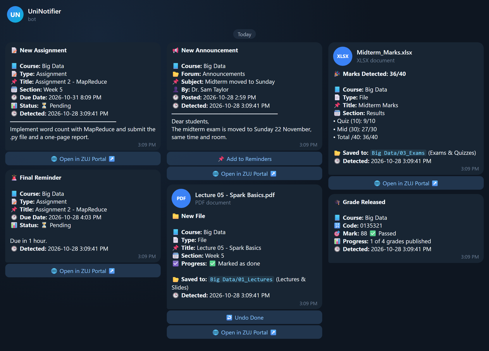
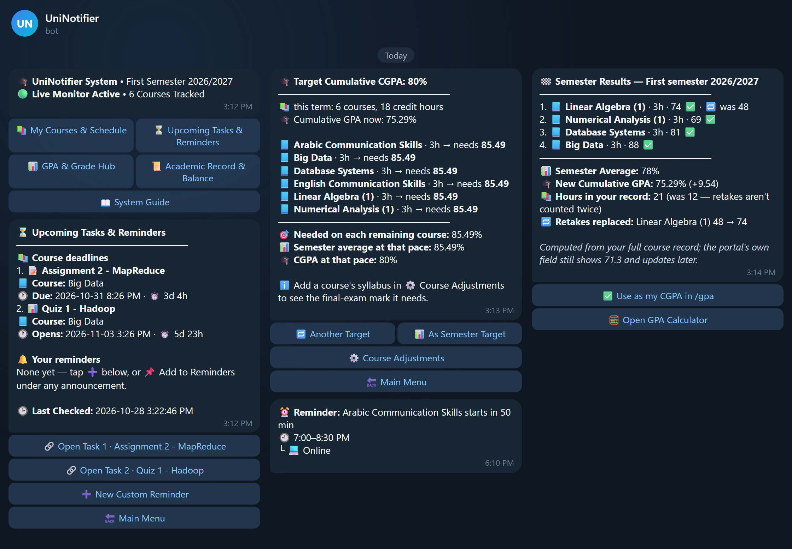
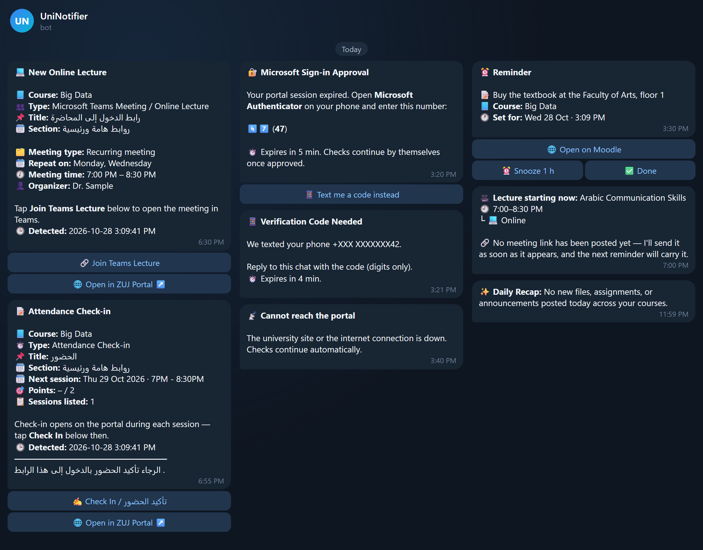

[العربية](README.ar.md) | **English**

---

<div align="center">

[](https://www.python.org/downloads/)
[](https://www.microsoft.com/windows)
[](https://github.com/Humam-Taibeh/UniNotifier/actions/workflows/tests.yml)
[](https://github.com/PyCQA/pyflakes)
[](LICENSE)

</div>

# UniNotifier

**Your university, on your phone — the moment anything changes.**

UniNotifier watches Al-Zaytoonah University of Jordan's Moodle (`elearning.zuj.edu.jo`) from your
own Windows PC and sends everything that matters to a private Telegram bot of your own: new files,
assignments, quizzes, announcements and forum posts, deadline reminders, online-lecture alerts with a
**Join** button, your transcript and balance on demand, and a GPA planner. Every course file is saved
into a tidy folder per course.

It runs quietly in the background through two Windows scheduled tasks, needs no server and no
subscription, and nothing about you ever leaves your PC except the messages it sends to *your* bot.

- [Features](#features) · [What it looks like](#what-it-looks-like) · [How it fits together](#how-it-fits-together)
- [Setup in 6 steps](#setup-in-6-steps)
- [Everyday use](#everyday-use) · [Where everything lives](#where-everything-lives) · [Optional extras](#optional-extras)
- [Updating, pausing, uninstalling](#updating-pausing-uninstalling) · [Troubleshooting](#troubleshooting) · [Security & privacy](#security--privacy)
- Every behaviour in depth: **[docs/REFERENCE.md](docs/REFERENCE.md)**

---

## Features

| | |
|---|---|
| 📚 **Everything on Moodle, as it happens** | Files, folders, links, pages, labels, quizzes, assignments, forum posts and announcements, Teams lectures and attendance — each with its full text, a sharp screenshot, and the file itself (up to 45 MB). Edited text and re-uploaded files are reported too. |
| 🗂️ **A tidy archive** | Every file lands in `<Course>\01_Lectures`, `02_Assignments` or `03_Exams`, never twice; an instructor's new version takes its place and the old one moves to `_Old_Versions`. |
| ⏰ **Deadlines & lectures** | Assignment and quiz reminders 24 h and 1 h ahead (stopped by your submission), and every day at noon a list of every open task — Cambridge One too — with a loud 🚨 on the last day; online-lecture alerts an hour before and at the start, with 🎥 Join Meeting and ✍️ Check In — and, if you switch it on, automatic attendance check-in with a screenshot as proof (or a 🚨 to do it by hand). |
| 📌 **Your own reminders** | "Add to Reminders" under any notification, or a typed note — delivered at the exact minute. |
| 📊 **Grades & GPA** | Grade Needed for a semester or cumulative target, transcript and balance on demand, Finals Watch announcing each released grade. |
| 🛡️ **Quiet and self-healing** | ~10-second plain-HTTP checks every 15 minutes plus a tiny look every 2 minutes, retries, maintenance detection, Microsoft 2FA relayed to Telegram, a bot that restarts itself, and alerts when something needs you. |

---

## What it looks like

<p align="center">
  
</p>

**Alerts the moment they happen:** deadlines, announcements, new files (saved for you), marks and grades.

<p align="center">
  
</p>

**Your assistant:** menus, upcoming tasks, the GPA planner ("what do I need?") and your semester results.

<p align="center">
  
</p>

**Lectures, sign-in and reminders:** a Join button for Teams lectures, attendance, Microsoft 2FA answered from your phone, your own reminders.

*Previews drawn with the bot's real message texts and invented sample data — the people, courses and
marks are made up. In Telegram they look the same, in your own theme, with tappable buttons.*

---

## How it fits together

```
  SOURCES (read only)       YOUR WINDOWS PC                                                                YOU

+----------------------+    +------------------------------------------------+
| Moodle e-learning    |    | monitor.py     task "UniNotifier"              |
| elearning.zuj.edu.jo |<---| every 15 min: scan > diff > download > alert   |----+
| Microsoft SSO + 2FA  |    | sign-in, screenshots: headless Chromium        |    |
+----------------------+    +------------------------------------------------+    |
                                    |                            |                |
                                    | course files               | state          |
                                    v                            v                |    +----------------+
                            +------------------+    +------------------------+    +----> Telegram       |---> your phone:
                            | ARCHIVE_ROOT\    |    | data\  (git-ignored)   |         | Bot API        |     alerts, files
                            |  <Course>\       |    |  saved_items.json      |    +<---> (your bot)     |<--- taps, commands
                            |   01_Lectures    |    |  sessions, caches      |    |    +----------------+
                            |   02_Assignments |    |  logs\                 |    |
                            |   03_Exams       |    +------------------------+    |
                            +------------------+                 ^                |
+----------------------+                                         |                |
| Registration portal  |    +------------------------------------------------+    |
| portal.zuj.edu.jo    |<---| bot.py   task "UniNotifier_BotListener"        |    |
| transcript, balance  |    | always on: menus, reminders, lecture alerts,   |<---+
+----------------------+    | 2-min Moodle probe, /check -> monitor.py,      |
| Cambridge One        |    | portal answers: saved copy now, fresh behind,  |
| class assignments    |<---| Cambridge One every 30 min (optional)          |
| (optional)           |    +------------------------------------------------+
+----------------------+
```

- **`monitor.py` — the check.** Every 15 minutes it reads all your courses (plain HTTP with the
  saved session; Chromium only to sign in and take screenshots), compares them with what it saw
  last time (`data\saved_items.json`), files new documents into your archive, and sends what is new.
- **`bot.py` — the assistant.** Always on: answers your taps and commands, sends lecture and
  reminder alerts on the minute, takes a ~1 KB look at Moodle every 2 minutes (and starts a check at
  once when something is new), reads the registration portal when you ask — answering
  instantly from the last copy and refreshing it behind ("stale-while-revalidate") — plus, if you
  turn on automatic check-in, one look a week at your timetable there, and, if you turn it on,
  watches Cambridge One.
- **Telegram** is the only thing that leaves your PC: your bot, talking only to you.

---

## Setup in 6 steps

About 20 minutes. Every command below is typed in **PowerShell** (Start menu → "PowerShell"),
inside the project folder once you have it. The quickest way there: in File Explorer, open the project
folder, type `powershell` in the address bar and press Enter.

> **Shortcut:** after step 1, get the code (step 2's `git clone` — recommended, as every update is then
> one `git pull` — or **Code → Download ZIP** on GitHub, then unzip it) and create your bot (step 4) —
> then double-click **`install.bat`** in the project folder.
> It does the rest of steps 2 and 3 and most of step 5 for you (`.venv`, the packages, Chromium, your
> `.env` and `schedule.json` opened in Notepad) and ends with the doctor. Then continue with step 6.

### 1. Prerequisites

| You need | How to get it | Check |
|---|---|---|
| Windows 10 or 11 | — | — |
| **Python 3.11 or newer** | [python.org/downloads](https://www.python.org/downloads/) — its default **Python install manager** downloads Python by itself the first time you run `py --version`; with the classic installer instead, tick **"Add python.exe to PATH"** | `py --version` |
| **Git** | [git-scm.com/download/win](https://git-scm.com/download/win) (all defaults are fine) | `git --version` |
| Telegram | on your phone | — |
| Your ZUJ Microsoft account | the one you sign in to Moodle with, and the Authenticator app if you use it | — |

### 2. Get the code and create its private Python environment

```powershell
cd $HOME
git clone https://github.com/Humam-Taibeh/UniNotifier.git
cd UniNotifier
py -3 -m venv .venv
```

`.venv` is a private copy of Python for this project only; nothing is installed system-wide.
Keep the project in your user folder as shown, not inside OneDrive: syncing breaks `.venv` and locks
the files UniNotifier writes.

### 3. Install the dependencies and the browser

```powershell
.venv\Scripts\python -m pip install --upgrade pip
.venv\Scripts\pip install -r requirements.txt
.venv\Scripts\pip install --no-deps -e .
.venv\Scripts\python -m playwright install chromium
```

`requirements.txt` pins the exact package versions UniNotifier is tested with; the third line installs
UniNotifier itself, and the last one downloads the headless Chromium (~150 MB) used to sign in and take
screenshots.

### 4. Create your private Telegram bot

1. In Telegram, open **[@BotFather](https://t.me/BotFather)** → **Start** → send `/newbot`.
2. Choose a display name (e.g. *My Uni Bot*) and a username ending in `bot` (e.g. `my_uni_2027_bot`).
3. BotFather replies with a **token** like `123456789:AAH4x…` — keep it secret; it is your bot's password.
4. Open **[@userinfobot](https://t.me/userinfobot)** → **Start**. It replies with your **Id** (a number).
5. Open **your new bot** (the `t.me/<username>` link BotFather gave you) and press **Start** —
   a bot cannot message you before you have written to it once.

### 5. Fill in your settings and your timetable

```powershell
copy .env.example .env
notepad .env
```

Fill in the four **required** values — `ZUJ_USERNAME`, `ZUJ_PASSWORD`, `TELEGRAM_BOT_TOKEN`,
`TELEGRAM_CHAT_ID` (your Id from @userinfobot) — and put the same Id in `ADMIN_USER_ID`.
Everything else is optional and explained right there in the file; an empty value means "off".
Course files go to `Documents\University` unless you set another folder in `ARCHIVE_ROOT`
(`%USERPROFILE%` works there).

```powershell
copy schedule.example.json schedule.json
notepad schedule.json
```

Replace the example classes with your own week: for each class its day, start and end
time (24-hour), English and Arabic course name, section, and mode (`In-Person`, `Online` or
`Activity`). Online classes get lecture alerts. Optionally put your official timetable in
`assets\` as `Weekly_Academic_Schedule.pdf` / `Weekly_Schedule.png` (see [assets/README.md](assets/README.md)).

Now let the doctor check everything:

```powershell
.venv\Scripts\python -m uninotifier.doctor
```

```
[ OK ] Python 3.12.7
[ OK ] Settings (.env): everything required is filled in
[ OK ] Timetable: First Semester 2026/2027, 12 weekly classes
[ OK ] Course files are saved to C:\Users\you\Documents\University
[ OK ] Chromium for Playwright is installed
[ OK ] Telegram bot: @my_uni_2027_bot
[ OK ] The bot can message you
...
All set.
```

Every `[FAIL]` line comes with an arrow telling you exactly what to do.

### 6. First sign-in, first run, and switch it on

```powershell
# 1. sign in to Moodle once, in a visible browser window (approve Microsoft on your phone if asked)
.venv\Scripts\python -m uninotifier.tools.login_refresh

# 2. the first check: records what is on Moodle now, quietly, and says "monitoring activated"
.venv\Scripts\python monitor.py

# 3. a test message, to see Telegram works end to end
.venv\Scripts\python -m uninotifier.doctor --send

# 4. switch it on: the 15-minute check and the always-on bot, as Windows scheduled tasks
powershell -ExecutionPolicy Bypass -File scripts\setup_tasks.ps1
```

`setup_tasks.ps1` finds the project and its `.venv` by itself, runs the doctor once more, and
registers both tasks for your Windows account — no administrator rights needed:

| Task | Runs | Settings |
|---|---|---|
| `UniNotifier` | `monitor.py` every 15 minutes | catches up right after the PC wakes, waits for the network, one run at a time, 15-minute limit, runs on battery |
| `UniNotifier_BotListener` | `bot.py` at every sign-in, and right now | no time limit, restarted every minute if it fails, runs on battery |

Open your bot in Telegram and send **/start**. That's it — from now on it runs by itself.

> The first check never floods you: everything already on Moodle becomes the baseline. Only what
> appears afterwards is announced.

---

## Everyday use

Everything is buttons: send `/start` for the menu. A few commands are worth knowing:

| Command | What it does |
|---|---|
| `/start` | the dashboard and menu |
| `/tasks` | every open assignment, quiz and Cambridge One task, and your reminders |
| `/remind` | a new reminder |
| `/courses` · `/schedule` | your courses and lecturers · your timetable files |
| `/need` · `/gpa` | Grade Needed · GPA & Grade Hub |
| `/transcript` · `/balance` | from the registration portal (needs `PORTAL_*` in `.env`) |
| `/finals` | Finals Watch during exam season |
| `/check` | run a check right now |
| `/help` | the System Guide |

The bot answers only you (`ADMIN_USER_ID`); anyone else who finds it gets no reply, and you are told.

---

## Where everything lives

| Path | What | In Git? |
|---|---|---|
| `.env` | your settings and passwords (from `.env.example`) | **never** |
| `schedule.json` | your timetable (from `schedule.example.json`) | **never** |
| `assets\` | your timetable PDF / PNG (optional) | **never** |
| `data\` | everything the program writes: tracker state, Moodle / portal sessions, caches | **never** |
| `data\logs\` | `monitor.log`, `bot.log` — the first place to look | **never** |
| `ARCHIVE_ROOT` (default `Documents\University`) | your course files, per course | outside the project |
| `src\uninotifier\` | the code | yes |
| `monitor.py`, `bot.py` | the two launchers the scheduled tasks start | yes |
| `install.bat` | the double-click installer (runs `scripts\install.ps1`) | yes |
| `scripts\` | `install.ps1`, `setup_tasks.ps1`, `remove_tasks.ps1`, `windows_recovery.ps1` | yes |

`data\` and `data\logs\` are created automatically on the first run. You can move the whole
project folder: run `scripts\setup_tasks.ps1` again afterwards so the tasks point at the new place.

---

## Optional extras

**Registration portal** — set `PORTAL_USERNAME` / `PORTAL_PASSWORD` for Transcript, Balance and
Finals Watch. The portal is only contacted when you ask (or while Finals Watch is on).

**Health monitoring** — a free [healthchecks.io](https://healthchecks.io) account tells you when your
PC is off or the program stopped. Create two checks and put their ping URLs in `HEALTHCHECK_URL`
(period 15 min, grace 1 h 45 min) and `BOT_HEALTHCHECK_URL` (period 5 min, grace 15 min).

**Off-PC backup of your state** — keep a copy of your tracker, GPA plan and reminders in a
**private** GitHub repository of its own (create an empty private repo first):

```powershell
.venv\Scripts\python -m uninotifier.gitsync --init https://github.com/<you>/<private-repo>.git
```

From then on every check commits and pushes changes to `saved_items.json`, `gpa.json` and
`reminders.json` — never sessions, cookies or logs. Run it without a URL for local history only.

**Cambridge One** (English courses) — set `CAMBRIDGE_ASSIGNMENTS_URL` and `CAMBRIDGE_UNTIL`, then
sign in once with `.venv\Scripts\python -m uninotifier.cambridge --login`. Cambridge ends a session
after about three days; add `CAMBRIDGE_EMAIL` and `CAMBRIDGE_PASSWORD` and the bot signs in again by
itself, otherwise it asks you on Telegram to repeat `--login`.

**Surviving Windows Update restarts** — the tasks run while you are signed in.
`scripts\windows_recovery.ps1` (run as administrator; `-Undo` reverses it) stops Windows from
restarting the PC by itself while you are signed in. See [docs/REFERENCE.md](docs/REFERENCE.md).

---

## Updating, pausing, uninstalling

```powershell
# update to the latest version
git pull
.venv\Scripts\pip install -r requirements.txt
.venv\Scripts\python -m playwright install chromium               # a new Playwright needs its own Chromium
powershell -ExecutionPolicy Bypass -File scripts\setup_tasks.ps1     # restarts the bot on the new code

# pause / resume everything
Disable-ScheduledTask UniNotifier; Stop-ScheduledTask UniNotifier_BotListener
Enable-ScheduledTask UniNotifier; Start-ScheduledTask UniNotifier_BotListener

# remove the scheduled tasks (your settings, data and course files stay)
powershell -ExecutionPolicy Bypass -File scripts\remove_tasks.ps1
```

**Downloaded the ZIP instead of cloning?** `git pull` only works in a clone. Download and extract the
new ZIP, copy `.env`, `schedule.json`, `assets\` and `data\` from your old folder into the new one,
double-click `install.bat` there, then run `scripts\setup_tasks.ps1` from the new folder so the tasks
point at it, and delete the old folder. Or switch to a clone once (step 2): every later update is then
the four lines above.

To uninstall completely, remove the tasks, then delete the project folder (and your archive
folder, if you no longer want the course files).

---

## Troubleshooting

Start with `.venv\Scripts\python -m uninotifier.doctor` — it checks everything and says what to do.
Then look at `data\logs\monitor.log` and `data\logs\bot.log`.

| Symptom | Fix |
|---|---|
| *"UniNotifier can't start - some settings in .env need your attention"* | the list under it names each setting; fix `.env` and run the doctor |
| The doctor says *"The bot can't reach your chat yet"* | open your bot in Telegram and press **Start** |
| The bot doesn't answer | is `UniNotifier_BotListener` running? (`Get-ScheduledTask UniNotifier*`) — is `ADMIN_USER_ID` your own Id? |
| *"running scripts is disabled on this system"* | start the script as shown: `powershell -ExecutionPolicy Bypass -File scripts\setup_tasks.ps1` |
| `No module named uninotifier` | run `.venv\Scripts\pip install --no-deps -e .` **from the project folder** (or double-click `install.bat` again) |
| `Executable doesn't exist … chromium` | `.venv\Scripts\python -m playwright install chromium` |
| Microsoft asks for verification | the bot relays it to Telegram — approve it on your phone (or reply with the SMS code). Last resort: `.venv\Scripts\python -m uninotifier.tools.login_refresh` |
| The doctor says *"schedule.json still holds the example classes"* | replace them with your own week (step 5) — left as they are, the bot would announce lectures you don't have |
| *"schedule.json needs fixing"* on Telegram | the message lists each mistake; reminders keep using the last good copy until it is fixed |
| Nothing happens after a restart | sign in to Windows — the tasks run while you are signed in; checks catch up by themselves |

---

## Security & privacy

- **Your passwords stay in `.env`** on your PC. It is git-ignored, and every value in it is masked in
  logs and in error alerts.
- **Single owner.** The bot serves only `ADMIN_USER_ID` in your private chat; strangers, groups and
  forwarded messages are dropped silently.
- **No personal file is tracked.** `.env`, `schedule.json`, `assets\`, `data\` and logs are all
  git-ignored, and a test fails if one ever is. Before you `git push`, `git status` should list none of them.
- **Read-only on Moodle**, except the manual *Mark as done* tick you press yourself and the automatic
  tick for files it saved; assignments and quizzes are never touched.
- **Unofficial, and yours to use responsibly.** UniNotifier is an independent student project. It is not
  affiliated with, endorsed or supported by Al-Zaytoonah University, Moodle, Microsoft, Telegram or
  Cambridge. It signs in with *your own* account, the way you would — use it only with your own account,
  in line with the university's rules, and at your own risk (see the warranty notice in [LICENSE](LICENSE)).
- **Found a security problem?** Please report it privately — see [SECURITY.md](SECURITY.md).

---

## For developers

```powershell
.venv\Scripts\pip install -r requirements-dev.txt
.venv\Scripts\python tests\test_architecture.py          # the whole suite, offline: no portal, no Telegram
.venv\Scripts\python -m pyflakes src tests monitor.py bot.py
```

The suite runs in a throw-away folder with a made-up `.env`, a fixture timetable and no network
(any outside connection fails the run), so it never reads your settings or touches your data — and a
fresh clone passes exactly like a configured PC. Architecture, every module and every behaviour:
**[docs/REFERENCE.md](docs/REFERENCE.md)**.

Want to help? **[CONTRIBUTING.md](CONTRIBUTING.md)** has the rules the tests enforce, on one page.
