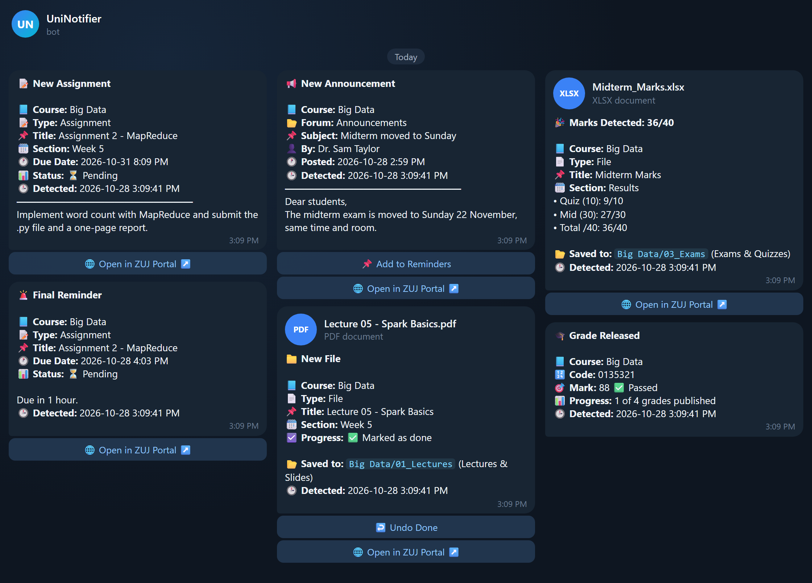
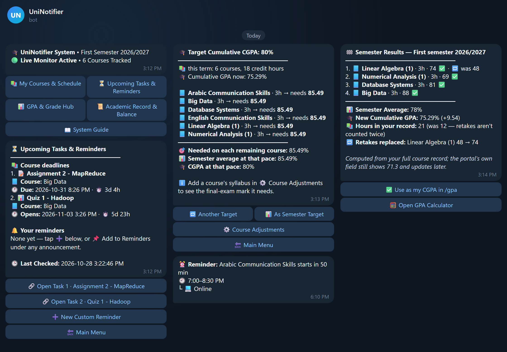
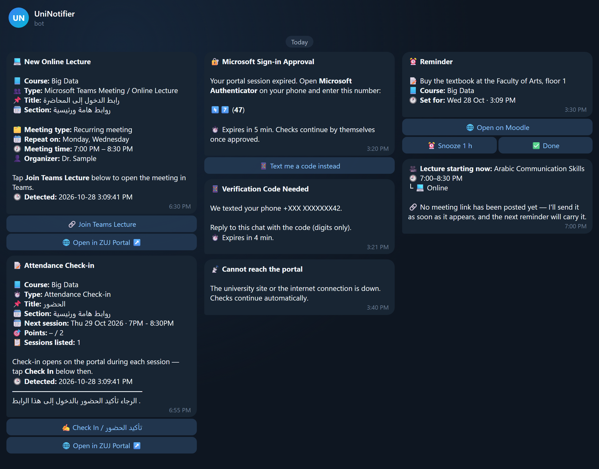

<a name="top"></a>

<div align="center">


# UniNotifier

**Your university, on your phone: the moment anything changes.**

[](https://github.com/Humam-Taibeh)
[](#getting-started)
[](https://github.com/Humam-Taibeh/UniNotifier/issues/new/choose)

[](https://www.python.org/downloads/)
[](https://www.microsoft.com/windows)
[](https://github.com/Humam-Taibeh/UniNotifier/actions/workflows/tests.yml)
[](https://github.com/PyCQA/pyflakes)
[](LICENSE)

</div>

## Screenshots

<p align="center">
  
</p>

**Alerts the moment they happen:** deadlines, announcements, new files (saved for you), marks and grades.

<p align="center">
  
</p>

**Your assistant:** menus, upcoming tasks, the GPA planner ("what do I need?") and your semester results.

<p align="center">
  
</p>

**Lectures, sign-in and reminders:** a Join button for Teams lectures, attendance, Microsoft 2FA answered from your phone, your own reminders.

*Previews drawn with the bot's real message texts and invented sample data — the people, courses and
marks are made up. In Slack they are cards with tappable buttons; in Telegram they read the same.*

## Overview

UniNotifier watches Al-Zaytoonah University of Jordan's Moodle (`elearning.zuj.edu.jo`) from your
own Windows PC and sends everything that matters to a private Slack app of your own, or to a Telegram bot: new files,
assignments, quizzes, announcements and forum posts, deadline reminders, online-lecture alerts with a
**Join** button, your transcript and balance on demand, and a GPA planner. Every course file is saved
into a tidy folder per course.

It runs quietly in the background through two Windows scheduled tasks, needs no server and no
subscription, and nothing about you ever leaves your PC except the messages it sends to *your* Slack.

> **Slack or Telegram — it works with both, the same way.** Slack is the recommended one because Telegram is
> currently blocked on many networks in Jordan; the installer asks which you want.

Every behaviour is described in depth in **[docs/REFERENCE.md](docs/REFERENCE.md)**.

## Features

| | |
|---|---|
| 📚 **Everything on Moodle, as it happens** | Files, folders, links, pages, labels, quizzes, assignments, forum posts and announcements, Teams lectures and attendance — each as a sharp screenshot of the item itself, or the file itself (up to 45 MB), in a short message. An edit says what changed (*Was* / *Now*); re-uploaded files are reported too. |
| 🗂️ **A tidy archive** | Every file lands in `<Course>\01_Lectures`, `02_Assignments` or `03_Exams`, never twice; an instructor's new version takes its place and the old one moves to `_Old_Versions`. |
| 📅 **Your timetable, read and drawn for you** | With the portal login in `.env`, the bot reads your weekly timetable from the registration portal by itself — every day, time, section, room and mode — builds its lecture alerts from it, and draws it as a picture and a PDF for the 📅 Weekly Timetable button. No file to write; a `schedule.json` or a timetable picture of your own still wins. |
| ⏰ **Deadlines & lectures** | Assignment and quiz reminders 24 h and 1 h ahead (stopped by your submission), and every day at noon a list of every open task — Cambridge One too — with a loud 🚨 on the last day; online-lecture alerts an hour before and at the start, with 🎥 Join Meeting and ✍️ Check In — and, if you switch it on, automatic attendance check-in with a screenshot as proof (or a 🚨 to do it by hand). Checking in does not replace attending: [you must be in the lecture](#disclaimer). |
| 📌 **Your own reminders** | "Add to Reminders" under any notification, or a typed note — delivered at the exact minute. |
| 🎉 **Your marks, found for you** | The mark of a quiz or assignment the moment Moodle shows it, with a picture of the page; and your row in any marks file an instructor uploads (Excel, Word, PDF, text) — found by the `STUDENT_ID` in your `.env`. A marks file it could not read says so. |
| 📊 **Grades & GPA** | Grade Needed for a semester or cumulative target; type a course's coursework total once (`42/60`) to see the best mark it can still reach and what the final needs. Transcript and balance on demand, Finals Watch announcing each released grade. |
| 🎓 **Your degree, from your own plan** | The transcript counts your study plan as the portal lists it — any major, any plan year: hours passed, this term, failed and not retaken, left now and after this term, the placement exams, and 📚 Remaining Courses group by group. A guest look-up does the same for a friend. |
| 🗓️ **Registration Plan** | What to register next term, worked out from your plan and its prerequisites: choose the hours (12 / 15 / 18, 21 in your graduation term or with an excellent CGPA; 9 in a summer term, 12 in your last one) and get a ✨ suggestion — a failed course first, then the course that opens the most after it — or ✋ choose the courses yourself from those open to you, with the hours and the rules checked as you tap. Every course that is not open yet is listed under its reason: the course to pass first, 90 hours passed (training, the graduation project — with the department head's approval), graduation term only (military science). It is advice only: nothing is ever registered for you — you register on the portal yourself, and the bot tells you when the portal's registration opens. |
| 📝 **Midterm marks, the moment they appear** | With the portal login set, the bot reads the exams site (`exams.zuj.edu.jo`, the same sign-in) every 15 minutes and sends each mark as it appears — the exam, the mark out of its maximum, the percentage — and tells you if a mark is changed later. It starts by saying which courses already have a mark and which it is waiting for; `/midterms` switches it off and on. |
| 🎒 **Absences, counted for you** | After your last lecture of the day the bot asks whether you went (once more at 10 PM if you did not answer), keeps the count per course, and warns you before a course's absence limit. With the portal login it also tells you when your tuition balance changes and when course registration opens. |
| 🛡️ **Quiet and self-healing** | ~10-second plain-HTTP checks every 15 minutes plus a tiny look every 2 minutes, retries, maintenance detection, Microsoft 2FA relayed to your chat, a bot that restarts itself, and alerts when something needs you. |

## Tech stack

| Area | Technology |
|---|---|
| Language | Python 3.11+ |
| Portal sign-in and browser automation | Playwright (Chromium) |
| Messaging | Slack (slack_sdk) or the Telegram Bot API |
| Reading course files and marks | openpyxl, xlrd, python-docx, pypdf, lxml |
| Scheduling | Windows Task Scheduler |
| Quality | Offline test suite and pyflakes in GitHub Actions on Windows, CodeQL, dependency review |

## Getting started

About 15 minutes, and no file to edit.

### 1. Install Python and Git (once)

| You need | How to get it | Check |
|---|---|---|
| Windows 10 or 11 | a PC that is on and online for most of the day: UniNotifier runs on it, so while it is off or asleep nothing is checked (it catches up when it wakes) | — |
| **Python 3.11 or newer** | [python.org/downloads](https://www.python.org/downloads/) — its default **Python install manager** downloads Python by itself the first time you run `py --version`; with the classic installer instead, tick **"Add python.exe to PATH"** | `py --version` |
| **Git** | [git-scm.com/download/win](https://git-scm.com/download/win) (all defaults are fine) | `git --version` |
| Slack | the free app on your phone and PC — you make your own workspace in step 2 | — |
| Your ZUJ Microsoft account | the one you sign in to Moodle with, and the Authenticator app if you use it | — |

### 2. Make your Slack (about 5 minutes, free)

Slack works on every network, and gives you the whole assistant — menus, buttons, cards. You make a small
private Slack of your own; nobody else is in it.

1. Go to **[slack.com/get-started](https://slack.com/get-started)** and create a free workspace (any name).
2. Go to **[api.slack.com/apps](https://api.slack.com/apps)** → **Create New App** → **From a manifest** →
   pick your workspace → **JSON**. The installer copies the app's settings for you: just paste them
   (**Ctrl+V**) and press **Next → Create**.
3. **Install to Workspace → Allow**, then copy the **Bot User OAuth Token** (it starts with `xoxb-`).
4. **Basic Information → App-Level Tokens → Generate Token and Scopes**: name it `socket`, add the scope
   `connections:write`, and copy the token (it starts with `xapp-`).

You do these while the installer waits for you — it tells you each step again on the screen, checks every
token you paste, and finds you in your Slack by itself. *(Prefer Telegram? The installer asks which one
you want; see [Telegram instead](#optional-extras).)*

### 3. Get UniNotifier and run the installer

Open **PowerShell** (Start menu → type "PowerShell") and type these four lines:

```powershell
cd $HOME
git clone https://github.com/Humam-Taibeh/UniNotifier.git
cd UniNotifier
.\install.bat
```

The installer does everything else, and tells you what it is doing at each step:

1. it prepares UniNotifier on your PC (a few minutes the first time);
2. it asks you **a few short questions** — where you want your messages (press **Enter** for Slack), your
   university e-mail and password, then your Slack tokens from step 2, then the registration portal
   login (optional, but it is what reads your timetable) and whether to check you in to online lectures;
3. it checks everything, opens a browser window to sign in to Moodle (approve Microsoft on your phone if
   it asks), makes the first, quiet check, and switches UniNotifier on.

Open the **UniNotifier** app in your Slack (under *Apps*) and type **menu**. That's it — from now on it
runs by itself, and your timetable arrives a few minutes later, read from the portal and drawn for you.

> **Use `git clone`, not Download ZIP:** only a cloned copy is told about new versions and fixes in the
> chat and can install them with one tap (see [Updating](#updating-pausing-uninstalling)).
> Keep the project in your user folder as shown, not inside OneDrive: syncing breaks it.
> The first check never floods you: everything already on Moodle becomes the baseline. Only what
> appears afterwards is announced.

<details>
<summary><b>Installing by hand, step by step</b> — if you prefer it, or the installer stopped</summary>

<br>

**a. The private Python environment** (in the project folder):

```powershell
py -3 -m venv .venv
```

`.venv` is a private copy of Python for this project only; nothing is installed system-wide.

**b. The packages and the browser:**

```powershell
.venv\Scripts\python -m pip install --upgrade pip
.venv\Scripts\pip install -r requirements.txt
.venv\Scripts\pip install --no-deps -e .
.venv\Scripts\python -m playwright install chromium
```

`requirements.txt` pins the exact package versions UniNotifier is tested with; the third line installs
UniNotifier itself, and the last one downloads the headless Chromium (~150 MB) used to sign in and take
screenshots.

**c. Your settings** — the same questions the installer asks:

```powershell
.venv\Scripts\python -m uninotifier.setup
```

It writes `.env` for you. Every setting is also explained in that file, if you ever want to change one
by hand; an empty value means "off". Course files go to `Documents\University` unless you set another
folder in `ARCHIVE_ROOT` (`%USERPROFILE%` works there).

**Your timetable needs no file** when the portal login is set: the bot reads it from the registration
portal by itself, tells you what it found, and draws it for the 📅 Weekly Timetable button (send
`/check` whenever your courses change). Without the portal login — or to write the timetable your own
way — make a `schedule.json`; one you wrote always wins over the portal's:

```powershell
copy schedule.example.json schedule.json
notepad schedule.json
```

Replace the example classes with your own week: for each class its day, start and end
time (24-hour), English and Arabic course name, section, and mode (`In-Person`, `Online` or
`Activity`). Online classes get lecture alerts. Optionally put a timetable picture of your own in
`assets\` as `Weekly_Academic_Schedule.pdf` / `Weekly_Schedule.png` — it is sent instead of the drawn
one (see [assets/README.md](assets/README.md)).

**d. Let the doctor check everything:**

```powershell
.venv\Scripts\python -m uninotifier.doctor
```

```
[ OK ] Python 3.12.7
[ OK ] Settings (.env): everything required is filled in
[ OK ] Timetable: read from the portal - First Semester 2026/2027, 12 weekly classes
[ OK ] Course files are saved to C:\Users\you\Documents\University
[ OK ] Chromium for Playwright is installed
[ OK ] Slack app in "My Uni" - your messages go to Slack
[ OK ] Test message sent to Slack
...
All set.
```

Every `[FAIL]` line comes with an arrow telling you exactly what to do.

**e. First sign-in, first run, and switch it on:**

```powershell
# 1. sign in to Moodle once, in a visible browser window (approve Microsoft on your phone if asked)
.venv\Scripts\python -m uninotifier.tools.login_refresh

# 2. the first check: records what is on Moodle now, quietly, and says "monitoring activated"
.venv\Scripts\python monitor.py

# 3. a test message, to see your messages arrive (Slack or Telegram)
.venv\Scripts\python -m uninotifier.doctor --send

# 4. switch it on: the 15-minute check and the always-on bot, as Windows scheduled tasks
powershell -ExecutionPolicy Bypass -File scripts\setup_tasks.ps1
```

`setup_tasks.ps1` finds the project and its `.venv` by itself, runs the doctor once more, and
registers both tasks for your Windows account — no administrator rights needed:

| Task | Runs | Settings |
|---|---|---|
| `UniNotifier` | `monitor.py` every 15 minutes | catches up right after the PC wakes, waits for the network, one run at a time, 15-minute limit, runs on battery |
| `UniNotifier_BotListener` | `bot.py` at every sign-in, and right now | no time limit, restarted every minute if it fails, runs on battery |

</details>

## Everyday use

Everything is buttons. In Slack, open the app's **Home** page or type **menu** in its chat; commands are
typed without the "/" (Slack keeps a leading "/" for itself): `tasks`, `check`, `need 85`. In Telegram,
send `/start`. A few commands are worth knowing:

| Command | What it does |
|---|---|
| `/start` (`menu` in Slack) | the dashboard and menu |
| `/tasks` | every open assignment, quiz and Cambridge One task, and your reminders |
| `/remind` | a new reminder |
| `/courses` · `/schedule` | your courses and lecturers · your timetable files |
| `/need` · `/gpa` | Grade Needed · GPA & Grade Hub |
| `/transcript` · `/balance` · `/record` | from the registration portal (needs `PORTAL_*` in `.env`) |
| `/midterms` · `/attendance` | Midterm Watch · your absences per course |
| `/register` | 🗓️ Registration Plan — what to register next term |
| `/settings` | ⚙️ Auto Check-In and Auto Mark as Done on or off, and 🆕 Check for Updates — in Slack a window opens over the chat |
| `/guest` | look up a friend's record with their own login (typed in a private form in Slack, never kept) |
| `/update` | 🆕 is there a new version — what is new, and ⬇️ Update Now |
| `/finals` · `/grades` | Finals Watch during exam season · check this term's grades now |
| `/check` | run a check right now |
| `/help` | a link to this guide |

The bot answers only you — `SLACK_USER` in Slack, `ADMIN_USER_ID` in Telegram; anyone else who finds it
gets no reply, and you are told.

## Optional extras

**Registration portal** — set `PORTAL_USERNAME` / `PORTAL_PASSWORD` for your timetable, Transcript,
Balance, Midterm Watch and Finals Watch. With them, the bot signs in to the university's sites by itself
only at these times — each look is one ordinary sign-in with your own account, and only reads:

| What | How often |
|---|---|
| your timetable (the portal's home page) | once a semester, and again on `/check` |
| Midterm Watch (`exams.zuj.edu.jo`) | every 15 minutes, while it is on (`/midterms`) |
| the tuition balance | every hour |
| whether course registration has opened | every 30 minutes |
| Finals Watch | every 30 minutes, only while you have it on |
| Transcript, Balance, Registration Plan | when you ask |

**Automatic attendance check-in** — ⚙️ **Settings** in the bot, or `AUTO_CHECK_IN=true` in `.env` (the setup
asks you; off by default):
the bot checks you in to every *online* lecture as soon as the instructor opens attendance and sends a
screenshot as proof, or tells you to do it by hand when it cannot. Never an in-person or activity day. It
needs the portal login above, which is how it knows which days are online. **You must still attend: a check-in by the bot does not replace being in the lecture.** It marks you
Present whether or not you attend, so switch it off for a lecture you will miss; your attendance is always
what your instructor decides (see [DISCLAIMER.md](DISCLAIMER.md)).

**Mark as done by itself** — ⚙️ **Settings** in the bot, or `AUTO_MARK_DONE=true` in `.env` (off by default):
when the bot has saved a
lecture file or opened a link for you, it ticks *Mark as done* on Moodle. Your instructor's completion
report then shows it as done, so it is your choice. Without it, every such message still has a
✅ Mark as done button you can press yourself. Assignments, quizzes and forums are never ticked.

**Telegram instead of Slack** — the installer asks where you want your messages; answer **2** for
Telegram (make a bot with [@BotFather](https://t.me/BotFather), `/newbot`, and paste its token; the installer
finds you when you press Start). Some networks in Jordan block Telegram, which is why Slack is the default.
To move a working install to Slack later: `.venv\Scripts\python -m uninotifier.setup --slack`. It walks you through a free Slack workspace and
app (the app's settings are copied for you to paste), finds you there, and from then on every
message goes to Slack — files, reminders, lecture alerts and alerts included, each as a card with
its buttons. The whole bot comes with it: its menus on the app's **Home** page, redrawn in place at
every press, and the commands typed without the "/" (`menu`, `tasks`, `check`). Back to Telegram:
`NOTIFY_VIA=telegram` in `.env`. The app's picture is yours to set: *Basic Information → App icon* →
`docs\images\uninotifier-icon.png`.

**Health monitoring** — a free [healthchecks.io](https://healthchecks.io) account tells you when your
PC is off or the program stopped. Create two checks and put their ping URLs in `HEALTHCHECK_URL`
(period 15 min, grace 45 min) and `BOT_HEALTHCHECK_URL` (period 5 min, grace 15 min).

**Off-PC backup of your state** — keep a copy of your tracker, GPA plan and reminders in a
**private** GitHub repository of its own (create an empty private repo first):

```powershell
.venv\Scripts\python -m uninotifier.gitsync --init https://github.com/<you>/<private-repo>.git
```

From then on every check commits and pushes changes to `saved_items.json`, `gpa.json` and
`reminders.json` — never sessions, cookies or logs. Run it without a URL for local history only.

**Cambridge One** (English courses) — set `CAMBRIDGE_ASSIGNMENTS_URL` and `CAMBRIDGE_UNTIL`, then
sign in once with `.venv\Scripts\python -m uninotifier.cambridge --login`. Cambridge ends a session
after about three days; add `CAMBRIDGE_EMAIL` and `CAMBRIDGE_PASSWORD` and the bot signs in again by
itself, otherwise it asks you in your chat to repeat `--login`. It stops by itself after
`CAMBRIDGE_UNTIL`, or earlier once your class no longer opens on Cambridge One for two days (the
course is over): you are told once, and `--login` turns it back on.

**Surviving Windows restarts (optional — you decide, nothing here runs by itself)**

The bot and the check are two ordinary Windows *scheduled tasks* — `UniNotifier` and
`UniNotifier_BotListener`, visible in Task Scheduler, created by `setup_tasks.ps1` without
administrator rights and removed by `remove_tasks.ps1`. They run while you are signed in. You can:

1. **Use the scheduled tasks** (recommended) — `setup_tasks.ps1`, as in the install steps.
2. **Run it by hand, with nothing installed in Windows** — `.venv\Scripts\python monitor.py` makes
   one check, `.venv\Scripts\python bot.py` starts the bot (it stops when you close it).
3. **Add restart protection to the tasks** — `scripts\windows_recovery.ps1`, below.

`windows_recovery.ps1` is a plain-text PowerShell file you can read in full. Nothing else in the project
calls it, it downloads nothing, uses no network and stores no password. It shows exactly which Windows
settings it will change (with `-Preview` it changes nothing and needs no administrator), asks you to
type `YES`, needs your UAC consent, logs every change in `data\windows_recovery.log` and is fully
reversed by `-Undo`. By default it does one thing: Windows Update stops restarting the PC by itself
while you are signed in. Signing in automatically after a restart is a separate, explicit
`-AutoSignIn`, only for an account that has **no** password (the script checks, and refuses otherwise).

```powershell
powershell -ExecutionPolicy Bypass -File scripts\windows_recovery.ps1 -Preview   # look first: nothing is changed
powershell -ExecutionPolicy Bypass -File scripts\windows_recovery.ps1            # Windows Update never restarts the PC while you are signed in
powershell -ExecutionPolicy Bypass -File scripts\windows_recovery.ps1 -Undo      # put everything back
```

Details in [docs/REFERENCE.md](docs/REFERENCE.md).

## Where everything lives

| Path | What | In Git? |
|---|---|---|
| `.env` | your settings and passwords (from `.env.example`) | **never** |
| `schedule.json` | a timetable you wrote yourself (from `schedule.example.json`) — optional: without it the bot reads the portal's | **never** |
| `assets\` | a timetable PDF / PNG of your own, or a `logo.png` for the drawn one (optional) | **never** |
| `data\` | everything the program writes: tracker state, Moodle / portal sessions, caches | **never** |
| `data\logs\` | `monitor.log`, `bot.log` — the first place to look | **never** |
| `ARCHIVE_ROOT` (default `Documents\University`) | your course files, per course | outside the project |
| `src\uninotifier\` | the code | yes |
| `monitor.py`, `bot.py` | the two launchers the scheduled tasks start | yes |
| `install.bat` | the double-click installer (runs `scripts\install.ps1`) | yes |
| `scripts\` | `install.ps1`, `setup_tasks.ps1`, `remove_tasks.ps1`, `windows_recovery.ps1` | yes |

`data\` and `data\logs\` are created automatically on the first run. You can move the whole
project folder: run `scripts\setup_tasks.ps1` again afterwards so the tasks point at the new place.

## Updating, pausing, uninstalling

**The bot tells you when a new version is ready** — once a day it looks at the repository you cloned, and sends one message, 🆕 *A new version of UniNotifier is ready*. It says what is new in plain words (the developer writes these notes in [NEWS.md](NEWS.md); a notice about a known problem reaches you the same way) and has two buttons: ⬇️ **Update Now** installs the version and restarts the bot — about a minute, your `.env`, `schedule.json` and data untouched — and ⏰ **Later** leaves it for `/update`, which looks at once whenever you send it. Nothing is ever installed without your press, and a version that does not start is taken back. This needs a copy made with `git clone`. By hand, it is:

```powershell
# update to the latest version
git pull
.venv\Scripts\pip install -r requirements.txt
.venv\Scripts\python -m playwright install chromium               # a new Playwright needs its own Chromium
powershell -ExecutionPolicy Bypass -File scripts\setup_tasks.ps1     # restarts the bot on the new code

# pause / resume everything
Disable-ScheduledTask UniNotifier; Stop-ScheduledTask UniNotifier_BotListener
Enable-ScheduledTask UniNotifier; Start-ScheduledTask UniNotifier_BotListener

# remove the scheduled tasks (your settings, data and course files stay)
powershell -ExecutionPolicy Bypass -File scripts\remove_tasks.ps1
```

**Downloaded the ZIP instead of cloning?** `git pull` only works in a clone. Download and extract the
new ZIP, copy `.env`, `schedule.json`, `assets\` and `data\` from your old folder into the new one,
double-click `install.bat` there, then run `scripts\setup_tasks.ps1` from the new folder so the tasks
point at it, and delete the old folder. Or switch to a clone once (step 3): every later update is then
the four lines above.

To uninstall completely, remove the tasks, then delete the project folder (and your archive
folder, if you no longer want the course files).

## Troubleshooting

Start with `.venv\Scripts\python -m uninotifier.doctor` — it checks everything and says what to do.
Then look at `data\logs\monitor.log` and `data\logs\bot.log`.

| Symptom | Fix |
|---|---|
| *"UniNotifier can't start - some settings in .env need your attention"* | the list under it names each setting; fix `.env` and run the doctor |
| The doctor says *"The bot can't reach your chat yet"* (Telegram) | open your bot in Telegram and press **Start** |
| The doctor says *"this network blocks Telegram"* (nothing arrives, the internet works) | some providers and routers block Telegram's address. Try a phone hotspot to be sure; to fix it for good, turn on a VPN such as [Cloudflare WARP](https://one.one.one.one/) on the PC, or get your messages on Slack (*Optional extras*). Nothing is lost meanwhile: what could not be sent goes out once Telegram is reachable |
| Slack shows messages but the buttons do nothing | the App-Level Token (`xapp-`, scope `connections:write`) is missing or wrong: run `.venv\Scripts\python -m uninotifier.setup --slack` and paste it again |
| The bot doesn't answer | is `UniNotifier_BotListener` running? (`Get-ScheduledTask UniNotifier*`) — is `SLACK_USER` (Slack) or `ADMIN_USER_ID` (Telegram) you? The setup fills both in; `data\logs\bot.log` says why it stopped |
| *"running scripts is disabled on this system"* | start the script as shown: `powershell -ExecutionPolicy Bypass -File scripts\setup_tasks.ps1` |
| `No module named uninotifier` | run `.venv\Scripts\pip install --no-deps -e .` **from the project folder** (or double-click `install.bat` again) |
| `Executable doesn't exist … chromium` | `.venv\Scripts\python -m playwright install chromium` |
| Microsoft asks for verification | the bot relays it to Slack (or Telegram) — approve it on your phone (or reply with the SMS code). Last resort: `.venv\Scripts\python -m uninotifier.tools.login_refresh` |
| The doctor says *"schedule.json still holds the example classes"* | replace them with your own week (*Installing by hand*, c.) — left as they are, the bot would announce lectures you don't have |
| *"schedule.json needs fixing"* in your chat | the message lists each mistake; reminders keep using the last good copy until it is fixed |
| Nothing happens after a restart | sign in to Windows — the tasks run while you are signed in; checks catch up by themselves |

## Architecture

```
  UNIVERSITY SITES          YOUR WINDOWS PC                                                                YOU

+----------------------+    +------------------------------------------------+
| Moodle e-learning    |    | monitor.py     task "UniNotifier"              |
| elearning.zuj.edu.jo |<---| every 15 min: scan > diff > download > alert   |----+
| Microsoft SSO + 2FA  |    | sign-in, screenshots: headless Chromium        |    |
+----------------------+    +------------------------------------------------+    |
                                    |                            |                |
                                    | course files               | state          |
                                    v                            v                |    +----------------+
                            +------------------+    +------------------------+    +----> Slack app      |---> your phone:
                            | ARCHIVE_ROOT\    |    | data\  (git-ignored)   |         | or Telegram    |     alerts, files
                            |  <Course>\       |    |  saved_items.json      |    +<---> (yours only)   |<--- taps, commands
                            |   01_Lectures    |    |  sessions, caches      |    |    +----------------+
                            |   02_Assignments |    |  logs\                 |    |
                            |   03_Exams       |    +------------------------+    |
                            +------------------+                 ^                |
+----------------------+                                         |                |
| Registration portal  |    +------------------------------------------------+    |
| portal.zuj.edu.jo    |<---| bot.py   task "UniNotifier_BotListener"        |    |
| transcript, balance  |    | always on: menus, reminders, lecture alerts,   |<---+
+----------------------+    | 2-min Moodle probe, /check -> monitor.py,      |
| Cambridge One        |    | portal answers: saved copy now, fresh behind,  |
| class assignments    |<---| Cambridge One every 30 min (optional)          |
| (optional)           |    +------------------------------------------------+
+----------------------+
```

- **`monitor.py` — the check.** Every 15 minutes it reads all your courses (plain HTTP with the
  saved session; Chromium only to sign in and take screenshots), compares them with what it saw
  last time (`data\saved_items.json`), files new documents into your archive, and sends what is new.
- **`bot.py` — the assistant.** Always on: answers your taps and commands, sends lecture and
  reminder alerts on the minute, takes a ~1 KB look at Moodle every 2 minutes (and starts a check at
  once when something is new), reads the registration portal when you ask — answering
  instantly from the last copy and refreshing it behind ("stale-while-revalidate") — plus the few
  unattended looks listed under [Optional extras](#optional-extras) (timetable, Midterm Watch,
  balance, registration), and, if you turn it on, watches Cambridge One.
- **Slack** (or Telegram) is the only thing that leaves your PC: your own app, talking only to you.

## Testing and development

```powershell
.venv\Scripts\pip install -r requirements-dev.txt
.venv\Scripts\python tests\test_architecture.py          # the whole suite, offline: no portal, no Telegram
.venv\Scripts\python -m pyflakes src tests monitor.py bot.py
```

The suite runs in a throw-away folder with a made-up `.env`, a fixture timetable and no network
(any outside connection fails the run), so it never reads your settings or touches your data — and a
fresh clone passes exactly like a configured PC. Architecture, every module and every behaviour:
**[docs/REFERENCE.md](docs/REFERENCE.md)**.

Want to help? **[CONTRIBUTING.md](CONTRIBUTING.md)** has the rules the tests enforce, on one page.

## Security and privacy

- **Your passwords stay in `.env`** on your PC. It is git-ignored, and every value in it is masked in
  logs and in error alerts.
- **Single owner.** The bot serves only you (`SLACK_USER` in Slack, `ADMIN_USER_ID` in Telegram) in your
  private chat; anyone else in the workspace, strangers, groups and forwarded messages are dropped silently.
- **No personal file is tracked.** `.env`, `schedule.json`, `assets\`, `data\` and logs are all
  git-ignored, and a test fails if one ever is. Before you `git push`, `git status` should list none of them.
- **It reads; it changes only what you switch on.** On Moodle it presses nothing by itself unless you
  chose it: *Mark as done* for saved files (`AUTO_MARK_DONE`) and online-lecture check-in
  (`AUTO_CHECK_IN`) — both off by default. The *Mark as done* button you press yourself always works.
  Assignments, quizzes and course registration are never touched; on the portal it only opens pages.
- **Your messages live where you read them.** What the bot sends you — marks, balance, screenshots — is
  kept by Slack (or Telegram) in your own private workspace or chat, like any message you receive there.
  A friend's login for `/guest` is typed into a private Slack form, used once and never saved.
- **Unofficial, and yours to use responsibly** — see [Disclaimer](#disclaimer).
- **Found a security problem?** Please report it privately — see [SECURITY.md](SECURITY.md).

## Disclaimer

UniNotifier is an independent student project that helps a student keep up with their own courses. It is
not affiliated with, endorsed or supported by Al-Zaytoonah University of Jordan, Moodle, Microsoft, Slack,
Telegram or Cambridge. It signs in with *your own* account, the way you would, at a gentle pace.

- **It assists; it never decides.** Your attendance, marks and registration are always what your
  instructors and the university record. Automatic check-in only does what you could do yourself — it
  marks you Present whether or not you attend, so switch it off for a lecture you will miss.
- **You must attend.** Automatic check-in is a reminder-and-button helper, not a replacement for attending.
  Even when the bot has checked you in, you have to be in the lecture. Using it for a lecture you do not
  attend may break university rules, and that responsibility is yours.
- **Your responsibility.** Use it only with your own account (and a friend's only with their consent), in
  line with the university's rules, and at your own risk. It comes with no warranty (see [LICENSE](LICENSE)).

The full text: **[DISCLAIMER.md](DISCLAIMER.md)**.

## How it was built

**AI coding tools wrote almost all of the code in this project.** I decide what to build, direct
the tools with requirements and prompts, and refine the result. I am a third-year Artificial
Intelligence student, still building my own programming fundamentals.

## License and legal

[PolyForm Noncommercial 1.0.0](LICENSE): free to use, study, change and share for any noncommercial purpose, with the copyright notice kept. Selling it, or using it in a paid product or service, is not allowed without the author's written permission. Version 1.0.0 was published under the MIT license; everything after it is under this one.

| Document | What it covers |
|---|---|
| [License](LICENSE) | What you may do with the code |
| [Disclaimer](DISCLAIMER.md) | Limits, risks and your responsibility |
| [Security](SECURITY.md) | How to report a vulnerability privately |
| [Contributing](CONTRIBUTING.md) | How to propose a change |
| [Code Of Conduct](CODE_OF_CONDUCT.md) | Expected behaviour |
| [Changelog](CHANGELOG.md) | What changed, by version |

---

<div align="center">

[](#top)
[](https://github.com/Humam-Taibeh)

</div>
